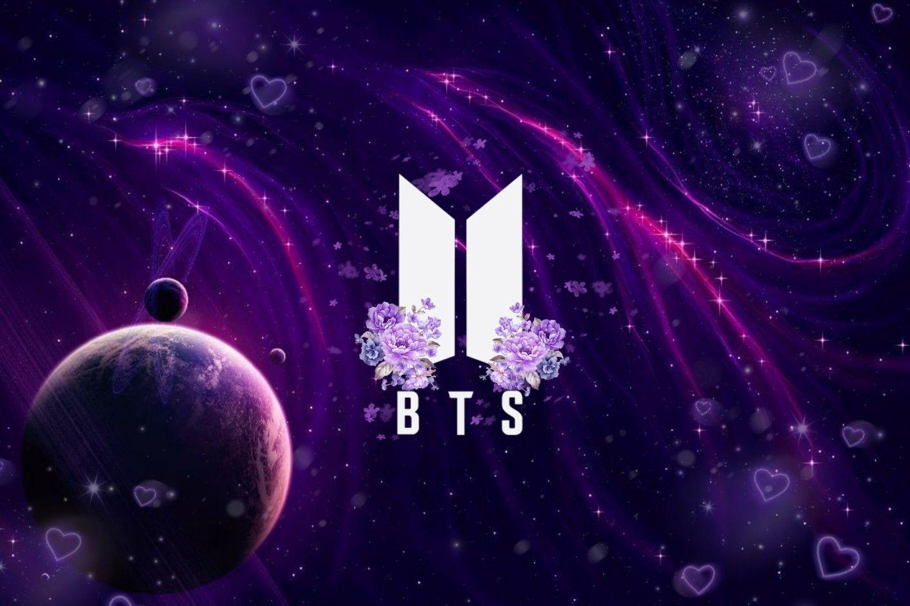

# 💜 BTS Purple Profile

<p align="center">
  
</p>

<h1 align="center">💜 BTS Purple Profile 💜</h1>

<p align="center">
  Una aplicación móvil creada con creatividad, tecnología y mucho amor por BTS y ARMY.
</p>

<p align="center">
  ✨ Construyendo mis sueños, un proyecto a la vez ✨
</p>

---

## 📱 Descripción del proyecto

**BTS Purple Profile** es una aplicación móvil desarrollada utilizando React Native y Expo, diseñada para presentar de manera creativa, moderna e interactiva la información personal, académica y profesional de su autora.

El proyecto combina el desarrollo de software con un diseño visual inspirado en BTS y su comunidad ARMY, utilizando una temática de colores morados, elementos galácticos, imágenes, animaciones y componentes personalizados.

La aplicación busca ofrecer una experiencia visual agradable, organizada y sencilla, permitiendo que los usuarios conozcan diferentes aspectos de la autora a través de sus distintas secciones.

Además, representa una oportunidad para poner en práctica los conocimientos adquiridos durante el proceso de formación en Análisis y Desarrollo de Software.

## 🎯 Objetivo general

Desarrollar una aplicación móvil interactiva que permita presentar información personal, académica, experiencia y gustos personales mediante una interfaz atractiva, organizada y adaptable, aplicando herramientas y tecnologías modernas de desarrollo de aplicaciones móviles.

## ✨ Características principales

La aplicación cuenta con diferentes secciones y funcionalidades:

### 🏠 1. Inicio
- Presentación personal de la autora.
- Fotografía de perfil.
- Descripción personal.
- Información general.
- Diseño personalizado inspirado en BTS.
- Fondo galáctico y elementos decorativos animados.
- Efectos visuales en diferentes componentes.

### 🎓 2. Estudios
- Presentación de la formación académica.
- Información relacionada con el proceso educativo.
- Organización visual mediante tarjetas.
- Diseño coherente con la temática de la aplicación.

### 💼 3. Experiencia
- Sección destinada a presentar información sobre la experiencia personal y profesional.
- Organización del contenido de manera clara.
- Componentes visuales personalizados.

### 🎨 4. Hobbies
- Presentación de los principales gustos e intereses personales.
- Fotografías relacionadas con diferentes actividades.
- Secciones dedicadas a BTS, música, dibujo, doramas y tecnología.
- Diseño visual atractivo y organizado.

### 📩 5. Contacto
- Acceso al correo electrónico mediante Gmail.
- Acceso al perfil de GitHub.
- Visualización del número telefónico.
- Opción para copiar el número de contacto.
- Botones interactivos con efectos de animación.

## 🛠️ Tecnologías utilizadas

Para el desarrollo de este proyecto se utilizaron las siguientes tecnologías y herramientas:

| Tecnología | Descripción |
|---|---|
| React Native | Desarrollo de la interfaz móvil. |
| Expo | Herramienta para facilitar el desarrollo y ejecución de la aplicación. |
| TypeScript | Lenguaje utilizado para escribir código con tipado estático. |
| Expo Router | Navegación y organización de las pantallas. |
| JavaScript | Lógica y funcionamiento de los componentes. |
| Git | Control de versiones del proyecto. |
| GitHub | Almacenamiento y publicación del código fuente. |

## 📂 Estructura del proyecto

La organización general del proyecto es la siguiente:

```text
BTS-Purple-Profile/
│
├── assets/
│   ├── bts/
│   │   ├── bts-portada.jpg
│   │   └── fondo-galaxia.jpg
│   │
│   ├── hobbies/
│   │   ├── bts.jpg
│   │   ├── dibujo.jpg
│   │   ├── doramas.jpg
│   │   ├── musica.jpg
│   │   └── tecnologia.jpg
│   │
│   └── perfil.png
│
├── src/
│   ├── app/
│   │   ├── _layout.tsx
│   │   ├── index.tsx
│   │   ├── estudios.tsx
│   │   ├── experiencia.tsx
│   │   ├── hobbies.tsx
│   │   └── explore.tsx
│   │
│   └── components/
│       ├── MiBoton.tsx
│       ├── TarjetaEstudio.tsx
│       ├── TarjetaExperiencia.tsx
│       └── TarjetaHobby.tsx
│
├── app.json
├── package.json
├── package-lock.json
└── README.md
```

## 🚀 Instalación y ejecución

Si deseas descargar y ejecutar este proyecto en tu equipo, sigue estos pasos:

**1. Clonar el repositorio**

```bash
git clone https://github.com/mgabrielarova17/Hoja-De-Vida.git
```

**2. Ingresar a la carpeta del proyecto**

```bash
cd BTS-Purple-Profile
```

**3. Instalar las dependencias**

```bash
npm install
```

**4. Iniciar el proyecto**

```bash
npx expo start
```

**5. Ejecutar la aplicación**

- Escanea el código QR con Expo Go desde tu dispositivo móvil.
- Presiona `w` para abrir la versión web, si está configurada.
- Presiona `a` para utilizar un emulador de Android compatible.

## 💜 Diseño y experiencia de usuario

La identidad visual de BTS Purple Profile está inspirada en el universo de BTS y ARMY.

Se utilizan principalmente:

- Tonalidades moradas y violetas.
- Fondos galácticos.
- Fotografías e imágenes personalizadas.
- Tarjetas con bordes redondeados.
- Iconos representativos.
- Animaciones y efectos interactivos.
- Navegación mediante pestañas.

Cada pantalla mantiene una identidad visual consistente para ofrecer una experiencia agradable y fácil de utilizar.

## 📚 Aprendizajes y conocimientos aplicados

Durante el desarrollo de esta aplicación se pusieron en práctica diferentes conocimientos relacionados con el desarrollo de software:

- Creación y organización de proyectos con Expo.
- Desarrollo de interfaces con React Native.
- Uso de componentes reutilizables.
- Navegación entre pantallas.
- Implementación de imágenes y recursos multimedia.
- Aplicación de estilos personalizados.
- Uso de animaciones.
- Implementación de botones interactivos.
- Integración de enlaces externos.
- Gestión de dependencias.
- Control de versiones mediante Git y GitHub.

## 🔮 Posibles mejoras futuras

El proyecto puede continuar evolucionando mediante la incorporación de nuevas funcionalidades, entre ellas:

- Nuevas secciones de información personal.
- Galería multimedia.
- Mejoras en las animaciones.
- Nuevas opciones de personalización.
- Adaptación de la interfaz a diferentes dispositivos.
- Incorporación de nuevas funcionalidades interactivas.

## 👩‍💻 Autora

**Mariana Gabriela Contreras Romero**

Aprendiz de Análisis y Desarrollo de Software.

Este proyecto representa una parte de mi proceso de aprendizaje, creatividad y crecimiento en el mundo del desarrollo de aplicaciones.

- GitHub: [@mgabrielarova17](https://github.com/mgabrielarova17)

## 💜 Agradecimientos

A BTS por ser una fuente de inspiración, creatividad y motivación.

A ARMY por representar una comunidad llena de apoyo, unión y cariño.

Y, especialmente, a todas las personas que hacen parte de mi proceso de aprendizaje y me motivan a seguir construyendo mis sueños.

---

<p align="center">
  💜 BOR A HAE 💜
</p>

<p align="center">
  Hecho con dedicación, creatividad y mucho amor. ✨
</p>